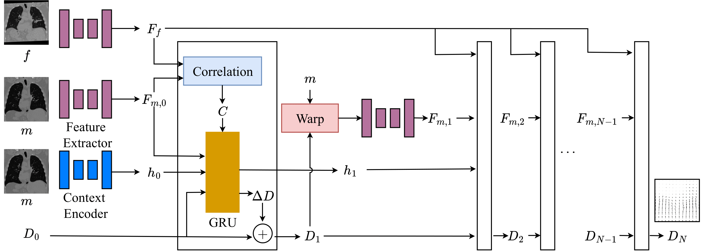

# RWCNet

This is the official repository for RWCNet: [link](https://www.mdpi.com/2076-3417/16/4/2084)



## Setup

```
pip install -r requirements.txt
```

## Training
* Currently, the model caches the hidden tensors as well as the flows at each level. This ends up taking **a lot** of space.
* The model training can be configured using the train_config.json. The options for the configuration can be inferred from `config.py`
* When running the full model against L2R data, please use the data format used for the L2R 2022 challenge.

To train the model on L2R data:

```
python l2r_train_eval.py l2r_dataset_json.json train_config.json
```

## Publication

If you find this repository useful, please cite:

Sivan, V.; Vujovic, T.; Ranabhat, R.K.; Wong, A.; Mclachlin, S.; Hardisty, M. Recurrence with Correlation Network for Medical Image Registration. Appl. Sci. 2026, 16, 2084. https://doi.org/10.3390/app16042084
